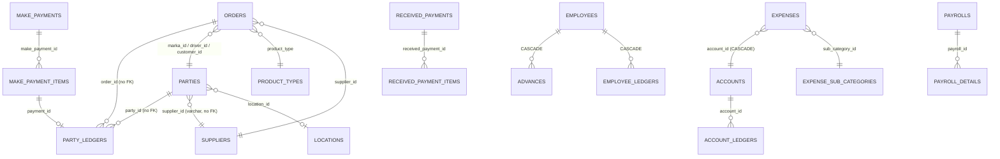

# 01 — Reference System Analysis ("Bricks ERP")

**Date:** 2026-10-18
**Inspected:**
- `Refrence Project/backup-2026-10-18_03-24-54.sql`: a full MariaDB 10.11 dump of database `gbricks`. It was loaded unchanged into a separate local scratch database `ref_gbricks` (Laragon MySQL 8.4) so the data could be queried. The original file was not modified.
- `Refrence Project/<33 folders>`: browser "Save Page As" copies of the live screens (rendered HTML plus compiled JS/CSS).

**Limitations:** there is no PHP source code (controllers, models, routes, validation). The business logic below is **inferred from the schema, the stored data and the form fields**. Statements marked *(inferred)* come from data patterns, not from code. Names and amounts from the data are deliberately not copied into these documents.

---

## 1. What the reference system actually is

The reference is a **brick trading / dealing ERP**, not a kiln production system.

Its central transaction is the **Order**. The business buys a load from a kiln (called a **"Marka"**), a **Driver** carries it, and the business sells it to a **Customer**, all in one entry. Profit per order is calculated as sale − purchase − carriage. Besides bricks, it also trades coal, cement, steel bars (sarya), crush, sand (rait), bond and chips.

**Not present in the reference at all** (no tables, no screens):
- Raw-brick production, stage movement, firing, Nakaasi/unloading, grade sorting
- Brick stock / inventory of any kind (stock is never tracked; every order is buy-and-sell at once)
- Material and fuel stock (soil, Kassu, coal, Bora, Tuka) and their consumption
- Piece-rate labour (per 1,000 bricks), Kamyaar, mistri/team contracts, weekly settlements
- Invoices, PDF generation, email notifications
- Multi-kiln / multi-company separation

So the reference is the guide for **parties, accounts, payments/receipts, expenses, payroll basics, reports, permissions and UI flow**. The **production side must be designed from the owner's notes**, with your answers filling in the gaps (see `05-open-questions.md`).

## 2. Technical architecture

| Item | Finding | Evidence |
|---|---|---|
| Framework | Laravel (10+/11 era) | `migrations` table, Laravel default tables (`password_reset_tokens`, `sessions`, `failed_jobs`) |
| Auth / API | Session login. Laravel Sanctum tokens also exist (977 issued), so a mobile/API client may exist *(unverified)* | `personal_access_tokens` |
| Permissions | `spatie/laravel-permission`: 18 module permissions, roles Admin/User, rights mostly given per user | `permissions`, `model_has_permissions` (139 rows) |
| Database | MariaDB 10.11 on Debian 12 | dump header |
| UI | Blade pages on the "Hyper" Bootstrap 5 admin theme, with jQuery, DataTables, ApexCharts and Summernote. Add/edit happens in modals. Dropdowns and dashboard cards load over AJAX | saved HTML/JS |
| Backup | In-app "Download Backup File" (mysqldump-php) | `backup` page, dump header |

## 3. Data model (44 tables)

| Area | Tables (row counts in the dump) |
|---|---|
| Master data | `product_types` (21), `locations` (8), `suppliers` (12), `parties` (1,599: Customer 1,028 / Marka 136 / Driver 435), `expense_categories` (12), `expense_sub_categories` (77), `accounts` (41: 26 `bank_account`, 15 `supplier_account`) |
| Trading | `orders` (14,283; May 2024 → Oct 2026) |
| Ledgers | `party_ledgers` (84,658), `account_ledgers` (43,310) |
| Treasury | `make_payments` (12,900) + `make_payment_items` (33,396); `received_payments` (6,933) + `received_payment_items` (18,654) |
| Expenses | `expenses` (4,182) |
| Capital / assets | `capitals`, `addcapitals`, `withdrawals`, `assets`, `assets_deposites`, `assets_withdrawals`: **all empty** |
| Payroll | `employees` (12), `employee_attendances` (3) / `_details` (24), `advances` (7), `advance_receivings` (7), `advance_salaries` (0), `payrolls` (0), `payroll_details` (0), `employee_ledgers` (14), `employee_salary_expenses` (0), `advance_issues` (0, legacy) |
| System | `users` (12), `roles`, `permissions`, `model_has_*`, `role_has_permissions`, `sessions`, `personal_access_tokens`, `failed_jobs`, `migrations` |

Product types in use include **AWAL, DOOM, KHINGAR, TILE** (these match the owner's grades), plus KACHI (raw), TOOTY (broken), BARSATI, Awal Barshi, Doom Barshi, Dara Bricks and Special. Non-brick products are Coal, CIMENT, CRUSH, RAIT, Sarya, BOND and CHIPS. The owner's grade **"Rora" does not appear** in the reference.

## 4. Business flows (traced from the data)

### 4.1 Order (the "Create Order" screen)
**Inputs:** date, location, marka (kiln), product, purchase qty, purchase rate, driver, carriage amount per unit, supplier, customer, sale rate, remarks.

**Calculations:**
- `total_purchase = qty × purchase_rate`
- `total_carriage = qty × carriage_amount`
- `grand_purchase = total_purchase + total_carriage`
- `total_sale = qty × sale_rate`
- `profit = total_sale − grand_purchase`

**Quantity unit *(inferred)*:** for bricks, qty is in **thousands of bricks**. For example, qty 6 at a rate of 22,000 gives 132,000, so the rate is per 1,000 bricks. For coal the qty looks like tonnes. **No unit is stored anywhere.**

**Posting:** each order writes **3 party-ledger rows** and no cash rows (it is a credit transaction):
- Marka credited with the purchase
- Driver credited with the carriage
- Customer debited with the sale

**Edit:** an edit posts an extra "Order Updated" row holding only the difference (for example −11,900, then +1,400). The original rows stay. The *idea* is good (don't overwrite history), but delta rows are hard to audit. The new system uses reversal + re-post instead.

**Delete:** orders are hard-deleted. **95 deleted orders left 587 ledger rows behind**, so party balances still include orders that no longer exist.

**Transport:** the business pays the driver, and the carriage cost is built into the sale rate. This is the **opposite of the owner's statement** that the customer arranges and pays for transport (see Q-04).

### 4.2 Party ledger sign convention *(inferred)*
- Stored `balance` **> 0 means we owe the party** (payable); **< 0 means the party owes us** (receivable).
- Column `payment` acts as **credit** (raises the balance) and `received` acts as **debit**. The column names are misleading: customer receipts are stored under `payment`, and payments to drivers under `received`.
- Every row stores its own running balance, and `parties.balance` stores the current total as well.

### 4.3 Payments & Receiving voucher
- One voucher uses **one cash/bank account** and has **many lines**.
- Each line's "particular" is either a **Party** (it goes to the party ledger) or an **Account** (a transfer between our own accounts).
- The header stores the account's previous and updated balance.
- Received payments mirror the same structure.

This multi-line voucher is fast for operators and is worth keeping.

### 4.4 Accounts (cash/bank)
- Accounts include cash in hand, bank accounts, mobile wallets, **credit cards (negative balances)**, fuel-pump accounts and cash held by individual partners/agents (type `supplier_account`).
- Each account has an opening balance, a running balance, and a ledger (`payment` = out, `received` = in).
- Capital add/withdraw and asset screens exist but have never been used.

### 4.5 Expenses
- An expense records a name, amount, date, the account it was paid from, a category and a sub-category, and posts money out of that account.
- Several categories are **named after people**, so they appear to be used as per-person expense heads *(inferred)*.

### 4.6 Payroll (built, barely used)
- Employees are monthly-salary staff. Attendance is recorded as present/absent/leave.
- Monthly payroll calculates: basic, present days, bonus, increment, deduction, advance deduction and advance-salary deduction, giving the final salary.
- Advances can be repaid in cash or by salary deduction. Salary is paid from an account. Each employee has a ledger.
- **The data shows 0 payroll runs.** Only opening advances and their settlement were ever entered.
- **There is no piece-rate (per 1,000 bricks) labour at all.**

### 4.7 Reports and dashboard
- **Reports:**
  - Expense: by category, sub-category, account or date
  - Payments & received: by date; payables & receivables
  - Ledgers: cash account (all / by date), party (all / by date), supplier customer list
  - Orders: all, by party, by supplier
  - Party: party-wise orders, all customers payable/receivable, last transaction
  - Party statements: party and cash account, all-time or by date
  - Summary: by date, by supplier
  - Profit & loss: by date, by supplier, by customer
- **Dashboard:**
  - Today's sales, orders, profit, payments, receipts and expense
  - Marka/driver receivable and payable; overall receivable and payable
  - Charts: category-wise expense, and month-wise expense, orders and profit
- **Balance sheet:** Cash + Receivables + Fixed assets on one side, Capital + Payables on the other. It has **no stock, no profit/retained earnings and no double entry**, so it cannot truly balance.

### 4.8 Users and rights
Users get per-module checkboxes (Order, Product-Type, Supplier, Parties, Accounts, Payments, Expense, the various Reports, Ledger, User Management).

## 5. Integrity and design problems found (must NOT be repeated)

| # | Problem | Evidence in the dump | How the new system prevents it |
|---|---|---|---|
| 1 | Money stored as `double` and even `varchar` | `accounts.balance double`, `advances.advance_amount varchar`, `payroll_details.*` varchar | All money stored as **integer paisa**; no floats anywhere |
| 2 | Stored balances drift from their ledgers | **13 of 41 accounts** (≈ PKR 7.09M total difference) and **18 of 1,599 parties** (≈ PKR 1.27M) have a stored balance ≠ opening + sum of ledger rows | Balances are **derived** from an immutable double-entry journal. Any cached value is re-verified by an automated check |
| 3 | Hard delete leaves ledger rows behind | 95 deleted orders → 587 orphan ledger rows | Posted documents are never deleted. A **void creates a reversal entry** |
| 4 | Stored totals ≠ qty × rate | 35 orders | Totals are calculated **only on the server**, in integer arithmetic, and covered by tests |
| 5 | Two sources of truth disagree | `advances.advance_amount = 0` while `employee_ledgers` show the real advance amounts | One source of truth per fact |
| 6 | `ON DELETE CASCADE` on financial data | Deleting an account deletes its expenses and ledgers; deleting an employee deletes their advances and ledger | `RESTRICT` on all financial FKs; records are **archived**, not deleted |
| 7 | Missing / mismatched foreign keys | `party_ledgers`, `orders`, `make_payment_items` have no FKs; `int` vs `bigint` ids; `parties.supplier_id` is varchar | Every relation has a typed FK |
| 8 | HTML stored in data | `party_ledgers.remarks` contains `<h6>` markup | Structured fields; escaped output |
| 9 | No tenant separation | single-company schema | Every record carries `kiln_id`, enforced by global scope + policies + tests |
| 10 | Not double-entry | separate party/account ledgers with their own balances | Proper journal (debit = credit for every entry), with party/worker/cash ledgers as views |
| 11 | Invalid dates | `0000-00-00` timestamps in `accounts` | Strict SQL mode, validated dates |

## 6. What we will reuse from the reference

- **Menu and module structure:** Orders/Sales, Parties, Accounts, Payments & Receiving, Expenses, Payroll, Reports, Users, Backup.
- **Multi-line payment/receipt voucher:** one account, many parties or transfers.
- **Live-calculating order form:** totals and profit update as you type.
- **Report set:** party statements, cash-account statements, date-wise ledgers, payable/receivable, expense reports by category/sub-category/account, P&L by date/party.
- **Per-module permissions** (improved into roles + permissions per kiln).
- **Account kinds:** cash in hand, bank, wallet, credit card, cash held by a person, fuel pump.
- **Party types** (Customer, Kiln/Marka, Driver), extended into configurable party roles (Supplier, Contractor, …).
- **In-app backup download.**
- **Grade names** already used in practice: Awal, Doom, Khingar, Tile, Kachi, Tooty, Barsati, Awal Barshi, Doom Barshi.
