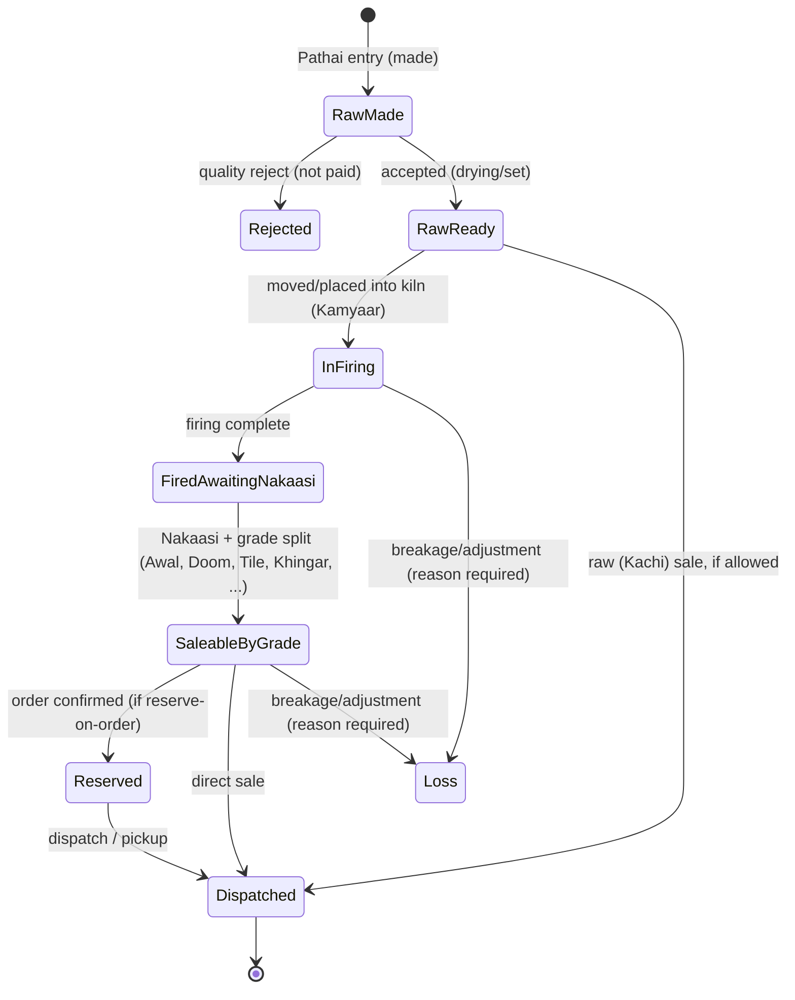
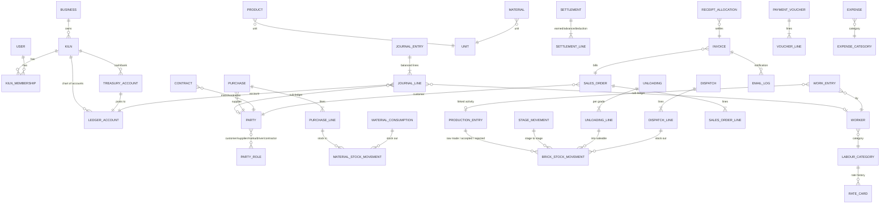

# 03 — Proposed Architecture and Data Model

Status: **proposal, awaiting approval.** Items marked *(needs answer)* depend on `05-open-questions.md`.

## 1. Technology stack

| Layer | Choice | Why |
|---|---|---|
| Language / framework | **PHP 8.3 + Laravel 13.x** (current stable) | You chose Laravel; the reference is Laravel; PHP 8.3 is already installed (Laragon) |
| Database | **MariaDB 10.11, locally and in production** (same as the live reference server) *(Q-07)*. M0–M7 were first built on MySQL 8.4 *(D-077)* | Only features that work on both MariaDB and MySQL. Strict SQL mode, InnoDB, utf8mb4 |
| UI | **Blade + Livewire 4 + Alpine.js + Tailwind CSS 4** (built with Vite) | Stays inside Laravel/Blade like the reference, but every action is validated and authorised on the server. Live totals in forms without a separate SPA/API. Fast to build and easy to maintain |
| Icons | One set only: **Lucide** (Blade components) | Clean, consistent and complete |
| Charts | ApexCharts (also used by the reference) | Only charts that answer an operational question |
| Permissions | `spatie/laravel-permission` v8 with **teams = kiln** | Same package as the reference, made kiln-aware |
| Audit log | `spatie/laravel-activitylog` | Who / when / before → after, plus a reason on voids |
| PDF | `mpdf/mpdf` (via a thin service) | Invoices and printable statements **in English and Urdu**. dompdf cannot shape/join Urdu letters; mPDF can (D-014) |
| Languages | Laravel translation files `lang/en.json` + `lang/ur.json`; `dir="rtl"` for Urdu; Tailwind logical properties (`ms-`/`me-`/`ps-`/`pe-`); self-hosted Urdu font | English + Urdu from day 1 (D-014) |
| Email | Laravel Mail on a **queue** (database driver), with an `email_logs` table | Retries, failure visibility, resend |
| Backup | `spatie/laravel-backup` v10 | Scheduled backups and in-app download |
| Tests | **Pest 4** (unit + feature, including Livewire screens) plus manual checks in the built-in browser at desktop and phone widths | Automated proof for every calculation and screen action |
| Quality | Larastan (PHPStan), Laravel Pint | Catches type bugs; keeps code style consistent |

Local setup note: the PHP `zip` extension is currently disabled in Laragon's `php.ini`. It will be enabled in M0 (Composer and backups need it).

## 2. Module boundaries

The code is organised by business domain, with the same internal layout in each:

```
app/
  Domain/
    Tenancy/        Business, Kiln, membership, current-kiln resolution
    Access/         Users, roles, permissions, policies
    Settings/       Kiln profile, units, products/grades, stages, number series
    Accounting/     Chart of accounts, journal posting engine, periods
    Parties/        Customers, suppliers, kilns (Marka), drivers, contractors
    Treasury/       Cash/bank accounts, transfers, payment & receipt vouchers, capital
    Expenses/
    Materials/      Materials, purchases, charges, consumption, material stock
    Production/     Raw production, stage movements, firing, Nakaasi, brick stock
    Labour/         Workers, labour categories, rate cards, work entries, attendance,
                    advances, settlements, contractor (mistri) contracts
    Sales/          Orders, dispatches, invoices, receipts allocation, (trading orders)
    Notifications/  Invoice email, email log, retry
    Reporting/      Statements, ledgers, P&L, balance sheet, dashboards
  Livewire/         Screens, grouped by the same domains
```

**Rule:** every change to money or stock goes through **one Action class** (for example `PostSale`, `RecordUnloading`, `SettleWorker`). Each Action:
1. checks permission and kiln access;
2. validates the input;
3. opens one DB transaction and locks the rows it depends on;
4. writes the document and its journal/stock entries;
5. writes the audit log;
6. commits — or, on any error, rolls everything back.

Screens never write to ledgers directly.

## 3. Multi-kiln tenancy

- **Deployment model (D-015): one installation + one database per client.** That gives the strongest isolation, simple per-client backups, and per-kiln billing.
- Inside an installation: `kilns` → users are linked through **kiln memberships** with **roles per kiln**. v1 runs with one kiln and shows no kiln switcher; a second kiln can be enabled later without schema changes.
- Every operational table has `kiln_id` (NOT NULL, FK, part of the main indexes).
- A `BelongsToKiln` trait adds a global scope (queries only ever see the current kiln) and sets `kiln_id` automatically on create. **It never trusts a `kiln_id` sent by the browser.**
- Route model binding is scoped to the kiln. Policies check that the user is a member of the record's kiln.
- Tests prove that a user of kiln A can neither see nor change anything belonging to kiln B, through any screen or action.

## 4. Money, quantities, numbering

- **Money:** stored as `BIGINT` **paisa** (PKR 1 = 100 paisa), handled through a `Money` value object and an Eloquent cast. Arithmetic is integer-only; rounding is **half-up to 1 paisa**, applied once per line. **No `float` / `double` anywhere.**
- **Rates:** stored as money per *basis quantity* (for example, PKR 1,250.00 per **1,000** bricks). Line amount = `round_half_up(rate × qty ÷ basis)`.
  - Worked example: 11,500 bricks × 1,200 per 1,000 = **PKR 13,800.00**.
- **Brick quantities:** whole bricks (`BIGINT`). Screens may also show "thousands".
- **Other quantities** (tons, cft, bags): `DECIMAL(18,3)`, with PHP arithmetic through `brick/math` (exact decimals).
- **Document numbers** (invoice, voucher, order): a gap-free sequence per kiln, per type and per year, allocated inside the posting transaction under a row lock.

## 5. Accounting design (double-entry)

Users never need to know accounting. They use simple screens (sale, receipt, payment, expense, settlement), and the system writes a balanced journal entry behind each one.

- **`ledger_accounts`** (chart of accounts per kiln), classified as asset / liability / equity / income / expense. It is seeded with system accounts:
  - Cash/bank accounts (one per treasury account)
  - Accounts Receivable (customers) and Accounts Payable (suppliers / kilns / drivers)
  - Workers Payable and Advances to Workers
  - Contractor Payable
  - Sales and Purchases / Cost of Sales
  - Labour, Material and Fuel Expense
  - Carriage, plus one expense account per expense category
  - Owner Capital / Drawings and Retained Earnings
- **`journal_entries`**:
  - kiln, date, number, `source` (the document that created it), memo
  - status `posted` / `reversed`, `reversal_of_id`
  - `idempotency_key` (unique), created_by
- **`journal_lines`**:
  - entry, ledger account
  - optional **party_id / worker_id** (this is how sub-ledgers work)
  - debit (paisa), credit (paisa); exactly one side > 0
- **Invariant:** for every entry, Σ debit = Σ credit. This is enforced by the posting engine, tested, and re-checked by an `artisan ledger:verify` command.
- **Posted entries are never edited or deleted.** Editing a document automatically posts a **reversal + new entry**, linked together. Voiding a document posts a reversal and requires a reason.
- **Views on the journal:**
  - Party statement = journal lines on the AR/AP account for that party
  - Worker ledger = lines on Workers Payable / Advances for that worker
  - Cash book = lines on that cash account
- **Reports from the journal:** trial balance, P&L and balance sheet all come straight from the journal, so they always agree with each other.
- **Daily reconciliation:** for each cash/bank account, opening + inflows − outflows = closing, with a day-close check.
- **Stock valuation** in the balance sheet is *(Q-42)*. The proposed v1 default: production costs are expensed, stock is reported in quantity, and an optional valuation report at average cost is added later.

## 6. Brick stock design

A **`brick_stock_movements`** ledger records every quantity change. Each movement has:
- kiln and date
- **from_stage** and **to_stage**
- product/grade (required once graded)
- qty, and the source document
- reversal link and reason

Stock at any stage = Σ in − Σ out. Nothing is ever just "overwritten".



The stage list and names are configurable *(Q-13)*. The **stage kinds** above are fixed, because the business rules depend on them:
- Only "Saleable" stock can be sold.
- "Fired, awaiting Nakaasi" is never saleable.
- A movement can never take a stage below zero. This is checked under a row lock, so two clerks entering at the same time cannot oversell.

Material stock uses the same pattern (`material_stock_movements`: purchase in, consumption out, adjustment).

## 7. Core data model (new system)



Every document table (purchase, production entry, unloading, settlement, invoice, voucher, expense…) has:
- `kiln_id`, `number`, `date`, `status` (draft / posted / void)
- `journal_entry_id` (when it affects money)
- `idempotency_key`, `created_by`, `voided_by`, `void_reason`

## 8. Security and reliability

- **Login:** rate-limited, strong password hashing, session-only (no API) in v1. Optional 2FA later.
- **Authorisation:** policies + permissions on every Livewire action, not just on hiding buttons.
- **Validation:** server-side on every input. Mass assignment guarded. All output escaped (no HTML stored in data).
- **Duplicate submissions:** each form carries a one-time idempotency key, stored as a unique column on the document. Buttons are also disabled while saving.
- **Concurrency:** DB transactions; row locks on stock balances and number sequences.
- **No cascading deletes on financial data** (`RESTRICT`). Master records are archived, not deleted.
- **Secrets** (SMTP, DB) only in `.env`, never in code, docs or logs.
- **Backups:** scheduled DB backups with retention; download for admins; tested restore procedure.
- **Errors:** logged with context; users see a clear message, never a stack trace.
